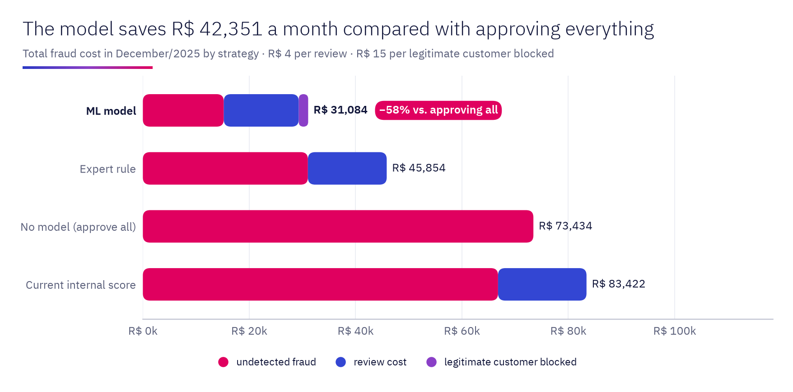
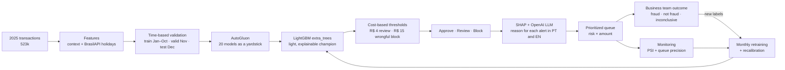
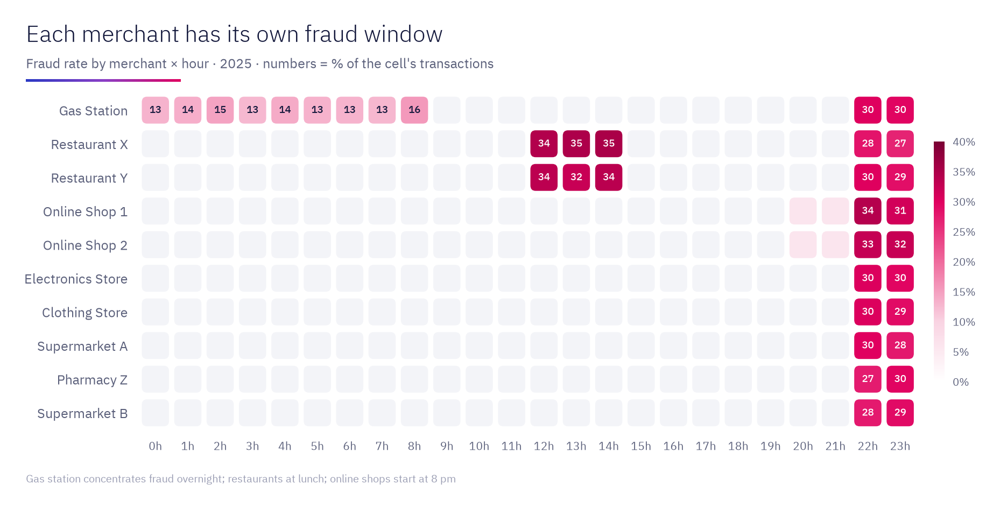
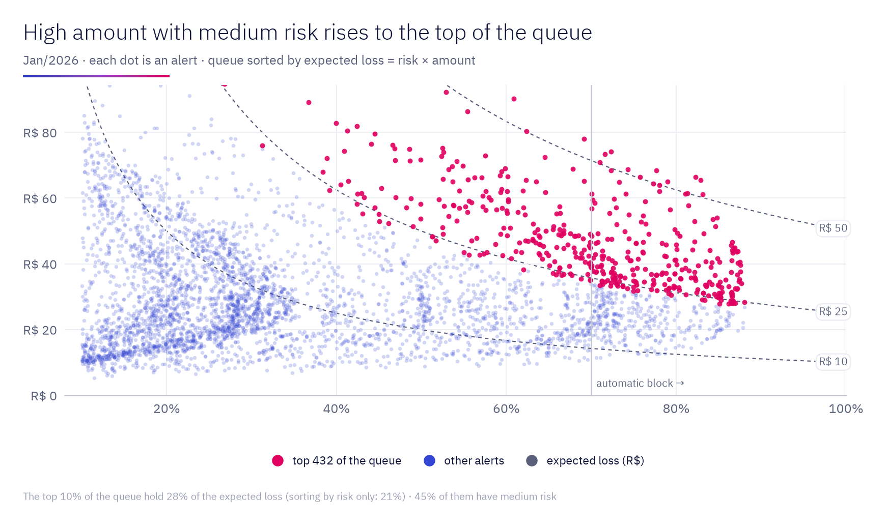
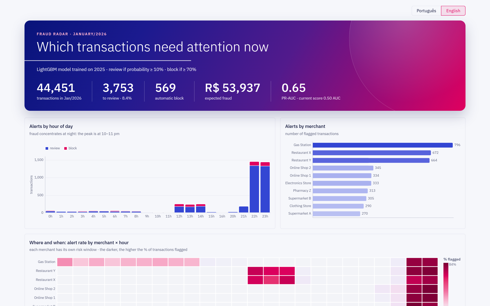
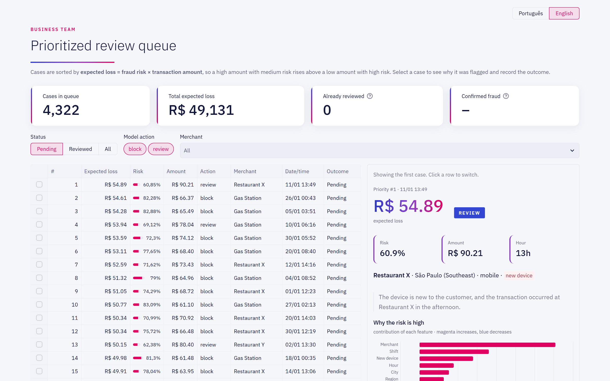
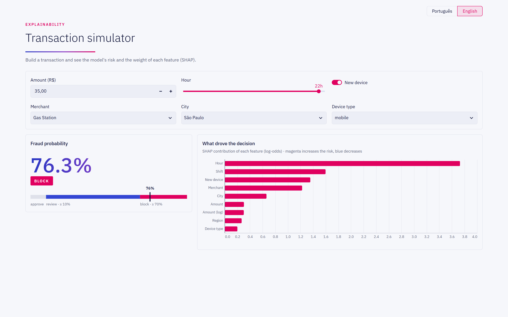
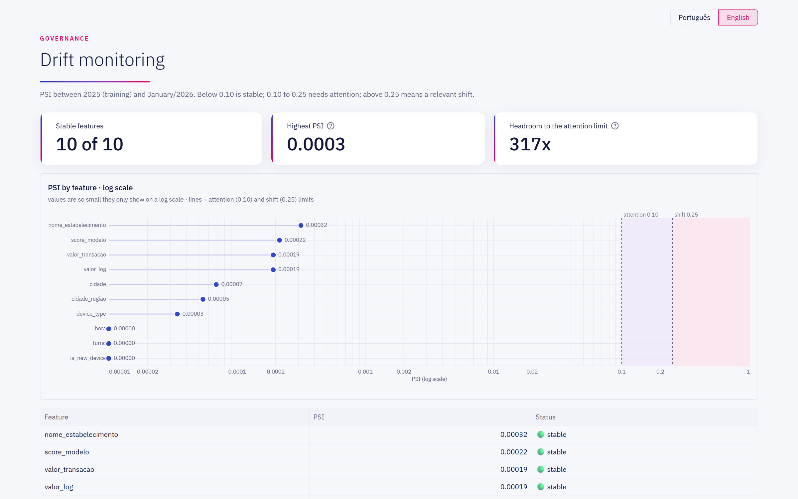

# Fraud Radar

[🇧🇷 Português](README.md) · **🇺🇸 English**

**Transaction fraud detection with cost-based decisions, a prioritized queue for the business team and an explanation for every alert.**

**▶ Live dashboard (PT/EN):** https://fraud-auto-ml.streamlit.app/ · **Slides (PT + EN):** [entrega/apresentacao_case_fraude.pdf](entrega/apresentacao_case_fraude.pdf)

Today fraud triage is almost entirely manual, and the score meant to help has an AUC of 0.50: a coin flip.
This project replaces that process with a model that gives each transaction a **fraud probability**, an **action**
(approve, review or block) and a **reason**, written by an LLM in Portuguese and English. Cases reach the business team
in a queue sorted by **expected loss (risk × amount)**, and every recorded review becomes a label for the next model version.

| | |
|---|---|
| **R$ 42,351** saved in the test month | −58% in fraud cost versus approving everything |
| **83%** of frauds caught | reviewing only 10% of transactions |
| **PR-AUC 0.65** | versus 0.05 for the current score (12x) and 0.25 for an expert rule |
| **79%** of the fraud amount prevented | with 7.9% of transactions in the review queue |

> Metrics come from the **December/2025 test**, a month the model never saw in training and that carries a new fraud
> pattern. It is the last labeled month; for January/2026 (unlabeled) there is only the expected-fraud estimate.



---

## How it works



## What the data showed

| Finding | Evidence |
|---|---|
| Hour is the strongest signal | 10–11 pm: ~30% of transactions are fraud; 9–11 am and 3–7 pm: none |
| A new device multiplies the risk | ~6x; combined with 10–11 pm it reaches 60% |
| Each merchant has its own window | gas station overnight, restaurants at lunch; gas station + SP/RJ + new device overnight ≈ 78% |
| The current score separates nothing | AUC 0.50 |
| Fraud changes over time | December: 5.4% fraud and a new pattern at 8–9 pm (*concept drift*) |
| Customer history and holidays don't help | tested and dropped by permutation importance (23 → 9 features) |



## Prioritized queue and calibration plan

Sorting by risk alone puts R$ 20 high-risk purchases on top while a large medium-risk purchase stays hidden. The
dashboard queue is sorted by **expected loss = probability × amount**: the top 10% hold 28% of the expected loss
(sorting by risk only: 21%), and 45% of them have medium risk.



In the dashboard, the business team sees the sorted queue, each case's features, **why the risk is high** (SHAP) and
records the **outcome**. Those outcomes are the calibration plan for the next versions:

- **Queue precision** (% of confirmed fraud among reviewed cases) is the main gauge. A drop above 20% triggers early retraining.
- Review and block thresholds are recalibrated with the actual observed cost.
- High-risk "not fraud" cases show where the model is wrong and go into training.
- A new version only ships after a month in *shadow mode*, compared with the previous one.

### Live dashboard · https://fraud-auto-ml.streamlit.app/

The dashboard has a **Português / English** switch that changes the whole interface, including each alert's reason.

| Jan/2026 overview | Prioritized queue |
|---|---|
|  |  |
| **Simulator** | **Drift** |
|  |  |

## Structure

```
├── case_fraude.ipynb              # the full reasoning (PT + EN): EDA, modeling, decision, explainability, drift
├── app/                           # Streamlit dashboard (PT/EN)
│   ├── streamlit_app.py           # Jan/26 overview · prioritized queue with outcomes · simulator · drift
│   ├── modelo_lgbm.txt            # final model
│   └── dados/                     # classified Jan/26 and PSI
├── transacoes_historico_2025.csv  # training base (523k transactions, fraud-labeled)
├── transacoes_jan2026.csv         # base to classify (44k transactions, unlabeled)
├── entrega/                       # classified Jan/26 (probability, action and reason in PT and EN)
│                                  # + apresentacao_case_fraude.pdf (PT and EN in one file)
├── artefatos/                     # metrics, charts (PT and EN), LLM cache and AutoGluon results
├── .env.example                   # template for the OpenAI key (.env is not committed)
├── dados_externos/                # holidays API cache (BrasilAPI)
└── extras/
    └── fontes/                    # chart font (OFL license)
```

## How to run

```bash
python -m venv .venv
.venv\Scripts\activate          # Linux/Mac: source .venv/bin/activate
pip install -r requirements.txt
```

1. LLM copilot (optional): copy `.env.example` to `.env` and fill in `OPENAI_API_KEY` and `OPENAI_MODEL`.
   Without a key, the notebook uses the saved cache (`artefatos/cache_motivos_llm.json`) or a template with the same facts.
2. Run `case_fraude.ipynb` (text in Portuguese and English; every chart is saved in both languages).
   With `USAR_AUTOGLUON = False` (default) it reads the saved benchmark results and runs in a few minutes; with `True`
   it retrains the 20 models (~25 min).
3. Dashboard: `streamlit run app/streamlit_app.py` (or use the live version: https://fraud-auto-ml.streamlit.app/)

**Reproducibility:** the notebook was re-run from scratch in a clean environment, with a different Python and library
versions, and the 139 saved metrics and the delivery CSV came out identical.

## Key decisions

| Decision | Why |
|---|---|
| PR-AUC instead of accuracy | With ~4% fraud, approving everything already gives 96% accuracy |
| Time-based validation, December test | The model is used in the future; December has drift and measures robustness |
| AutoGluon as yardstick, LightGBM as the model | Same performance as the best model (0.006 PR-AUC gap), but light and explainable |
| Cost-based thresholds in R$ | An explicit business decision, tunable without retraining |
| Queue by risk × amount | Analysts look first where the money is |
| The LLM writes, it doesn't decide | It only receives the 3 SHAP factors; structured, validated output; results cached |

## Limitations and next steps

- The data is synthetic: very clean patterns inflate metrics compared with the real world.
- Cost assumptions must be validated with the business team.
- Signals to add next: purchase geolocation × customer address, travel speed between cities
  (*impossible travel*) and *device fingerprint*.

**Author:** Isabel Valentim

**Stack:** Python · pandas · LightGBM · AutoGluon · SHAP · OpenAI API · Streamlit · Altair · Matplotlib · BrasilAPI
