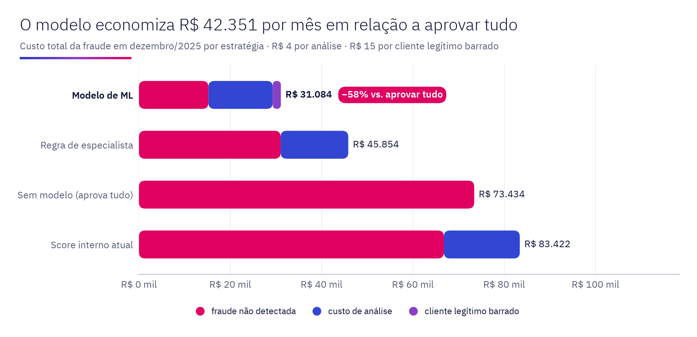
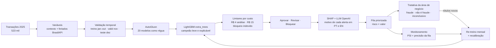
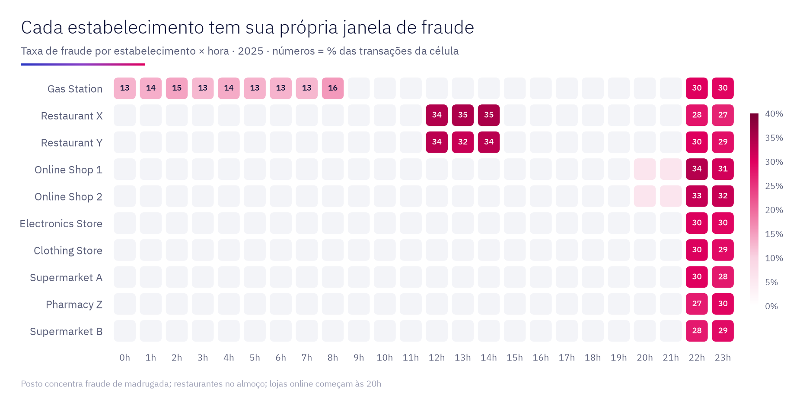
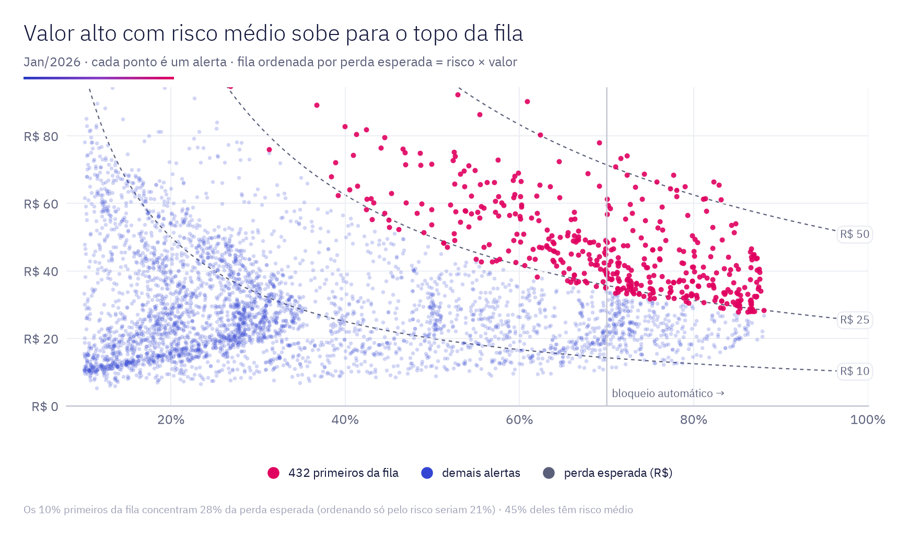
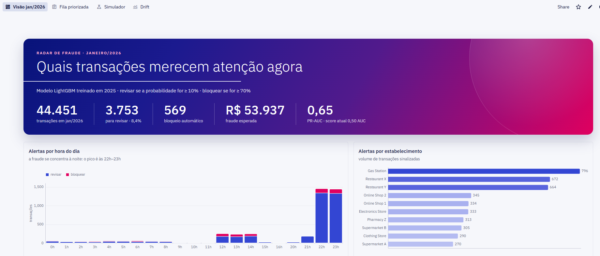
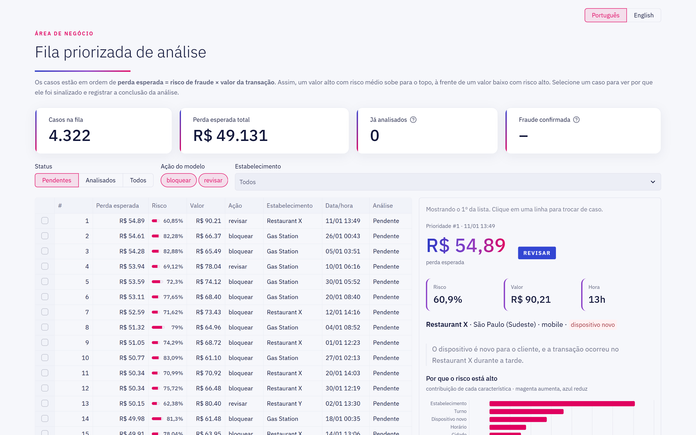
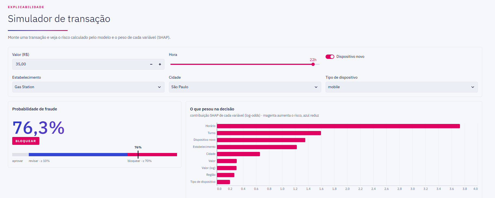
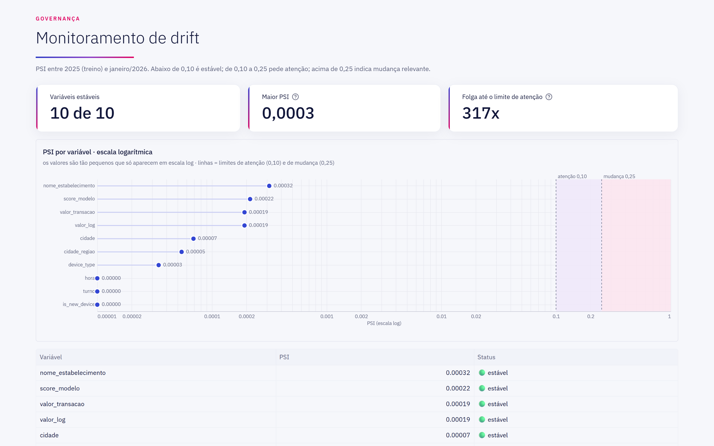

# Radar de Fraude

**🇧🇷 Português** · [🇺🇸 English](README.en.md)

**Detecção de fraude em transações com decisão por custo, fila priorizada para a área de negócio e explicação de cada alerta.**

**▶ Painel online (PT/EN):** https://fraud-auto-ml.streamlit.app/ · **Apresentação (PT + EN):** [entrega/apresentacao_case_fraude.pdf](entrega/apresentacao_case_fraude.pdf)

Hoje a triagem de fraude é quase toda manual, e o score usado para ajudar tem AUC 0,50: equivale a um sorteio.
Este projeto troca esse processo por um modelo que dá a cada transação uma **probabilidade de fraude**, uma **ação**
(aprovar, revisar ou bloquear) e o **motivo**, escrito por um LLM em português e inglês. Os casos chegam à área de negócio numa fila ordenada por
**perda esperada (risco × valor)**, e cada análise registrada vira rótulo para a próxima versão do modelo.

| | |
|---|---|
| **R$ 42.351** de economia no mês de teste | −58% no custo da fraude em relação a aprovar tudo |
| **83%** das fraudes capturadas | revisando só 10% das transações |
| **PR-AUC 0,65** | contra 0,05 do score atual (12x) e 0,25 de uma regra de especialista |
| **79%** do valor fraudado evitado | com 7,9% das transações na fila de análise |

> As métricas são do **teste em dezembro/2025**, um mês que o modelo nunca viu no treino e que traz um padrão novo de
> fraude. É o último mês com rótulo; para janeiro/2026 (sem rótulo) existe só a estimativa de fraude esperada.



---

## Como funciona



## O que os dados mostraram

| Achado | Evidência |
|---|---|
| O horário é o sinal mais forte | 22h–23h: ~30% das transações são fraude; das 9h às 11h e das 15h às 19h, nenhuma |
| Dispositivo novo multiplica o risco | ~6x; junto com 22h–23h chega a 60% |
| Cada estabelecimento tem sua janela | posto de madrugada, restaurantes no almoço; posto + SP/RJ + dispositivo novo de madrugada ≈ 78% |
| O score atual não separa nada | AUC 0,50 |
| A fraude muda com o tempo | dezembro: 5,4% de fraude e um padrão novo às 20h–21h (*concept drift*) |
| Histórico do cliente e feriados não ajudam | testados e descartados pela importância por permutação (23 → 9 variáveis) |



## Fila priorizada e plano de calibração

Ordenar só pelo risco põe no topo compras de R$ 20 com risco alto, enquanto uma compra alta com risco médio fica
escondida. A fila do painel é ordenada por **perda esperada = probabilidade × valor**: os 10% primeiros concentram
28% da perda esperada (ordenando só pelo risco seriam 21%), e 45% deles têm risco médio.



No painel, a área de negócio vê a fila ordenada, as características de cada caso, **por que o risco está alto** (SHAP)
e registra a **tratativa**. Essas conclusões são o plano de calibração das próximas versões:

- **Precisão da fila** (% de fraude confirmada entre os casos analisados) é o termômetro principal. Uma queda acima de 20% antecipa o re-treino.
- Os limiares de revisar e bloquear são recalibrados com o custo real observado.
- Casos "não é fraude" com risco alto mostram onde o modelo erra e entram no treino.
- Uma versão nova só entra depois de um mês em *shadow mode*, comparada com a anterior.

### Painel online · https://fraud-auto-ml.streamlit.app/

O painel tem um botão **Português / English** que troca toda a interface, inclusive o motivo de cada alerta.

| Visão jan/2026 | Fila priorizada |
|---|---|
|  |  |
| **Simulador** | **Drift** |
|  |  |

## Estrutura

```
├── case_fraude.ipynb              # todo o raciocínio: EDA, modelagem, decisão, explicabilidade, drift
├── app/                           # dashboard Streamlit
│   ├── streamlit_app.py           # visão jan/26 · fila priorizada com tratativa · simulador · drift
│   ├── modelo_lgbm.txt            # modelo final
│   └── dados/                     # jan/26 classificado e PSI
├── transacoes_historico_2025.csv  # base de treino (523 mil transações, com rótulo de fraude)
├── transacoes_jan2026.csv         # base a classificar (44 mil transações, sem rótulo)
├── entrega/                       # jan/26 classificado (probabilidade, ação e motivo em PT e EN)
│                                  # + apresentacao_case_fraude.pdf (PT e EN no mesmo arquivo)
├── artefatos/                     # métricas, gráficos (PT e EN), cache do LLM e resultados do AutoGluon
├── .env.example                   # modelo do .env com a chave da OpenAI (o .env não vai para o git)
├── dados_externos/                # cache da API de feriados (BrasilAPI)
└── extras/
    └── fontes/                    # fonte dos gráficos (licença OFL)
```


## Como rodar

```bash
python -m venv .venv
.venv\Scripts\activate          # Linux/Mac: source .venv/bin/activate
pip install -r requirements.txt
```

1. Copiloto com LLM (opcional): copie `.env.example` para `.env` e preencha `OPENAI_API_KEY` e `OPENAI_MODEL`.
   Sem chave, o notebook usa o cache salvo (`artefatos/cache_motivos_llm.json`) ou um template com os mesmos fatos.
2. Execute `case_fraude.ipynb` (texto em português e inglês; cada gráfico é salvo nos dois idiomas). Com `USAR_AUTOGLUON = False` (padrão), ele lê os resultados salvos do benchmark e roda
   em poucos minutos. Com `True`, re-treina os 20 modelos (~25 min).
3. Dashboard: `streamlit run app/streamlit_app.py` (ou acesse a versão online: https://fraud-auto-ml.streamlit.app/)

**Reprodutibilidade:** o notebook foi re-executado do zero num ambiente limpo, com outra versão de Python e das
bibliotecas, e as 139 métricas salvas e o CSV de entrega saíram idênticos.

## Decisões principais

| Decisão | Por quê |
|---|---|
| PR-AUC em vez de acurácia | Com ~4% de fraude, aprovar tudo já dá 96% de acurácia |
| Validação temporal, teste em dezembro | O modelo é usado no futuro; dezembro tem drift e mede a robustez |
| AutoGluon como régua, LightGBM como modelo | Mesma performance do melhor modelo (diferença de 0,006 de PR-AUC), mas leve e explicável |
| Limiares por custo em R$ | Decisão de negócio explícita e ajustável sem re-treinar |
| Fila por risco × valor | Quem analisa olha primeiro onde está o dinheiro |
| LLM só redige, não decide | Recebe apenas os 3 fatores do SHAP; saída estruturada e validada; resultado em cache |

## Limitações e próximos passos

- Os dados são sintéticos: padrões muito limpos inflam as métricas em relação ao mundo real.
- As premissas de custo precisam ser validadas com a área de negócio.
- Próximos sinais a incorporar: geolocalização da compra × endereço do cliente, velocidade entre cidades
  (*impossible travel*) e *device fingerprint*.

**Autora:** Isabel Valentim

**Stack:** Python · pandas · LightGBM · AutoGluon · SHAP · OpenAI API · Streamlit · Altair · Matplotlib · BrasilAPI
